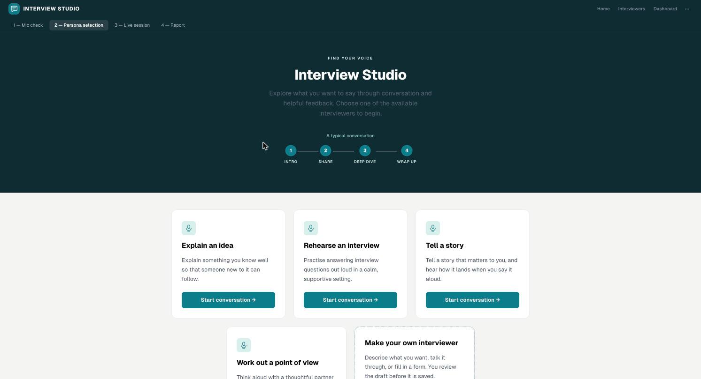
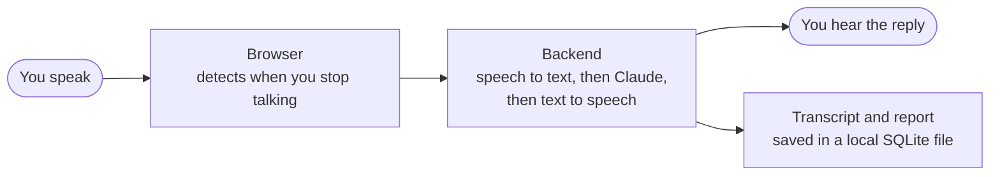

# Interview Studio

**Find your voice through guided conversation.** An AI interviewer asks you questions, follows up on your answers and gives you space to work out what you want to say. Afterwards you get a transcript and a written reflection on what you said and how you delivered it.



Use it to explore an idea, tell a story, rehearse an interview or work through a point of view. You can also build your own interviewers.

> **Status:** a single-user prototype that runs on your own machine. It is not a hosted service. See [Before you deploy it](docs/operations.md#before-you-put-this-on-a-network).

## How it works



A conversation moves through four phases (intro, share, deep dive, wrap up). When it ends, the report covers **Content** (what you said), **Delivery** (pace, pauses, answer length) and **Next steps**. Audio is never stored. [How it works](docs/how-it-works.md) explains each step with diagrams.

## Quick start

You need **Node.js 20 or later** and **git**. Check with `node -v`.

### 1. Try it without API keys

Mock mode uses scripted replies, so you can see the whole flow before paying for anything.

```sh
git clone https://github.com/mgwinthrop/interview-studio.git
cd interview-studio

npm --prefix apps/backend ci
npm --prefix apps/frontend ci
cp apps/backend/.env.example apps/backend/.env
cp apps/frontend/.env.example apps/frontend/.env.local
(cd apps/backend && npx prisma generate)
```

Start the backend in one terminal:

```sh
cd apps/backend
PROFILE=mock npm run dev
```

You should see `Server listening on 127.0.0.1:3001 (profile mock, auth local)`.

Start the frontend in a second terminal:

```sh
cd apps/frontend
npm run dev
```

Open <http://localhost:3000>. The app asks for microphone access before the first conversation, even in mock mode. To look around without a microphone, open <http://localhost:3000/avatar>.

### 2. Use real conversations

You need two API keys. Each provider bills your own account.

| Key | Used for | Where to get it |
|---|---|---|
| `ANTHROPIC_API_KEY` | The interviewer's questions and your report | [console.anthropic.com](https://console.anthropic.com/) |
| `ELEVENLABS_API_KEY` | Speech to text and the interviewer's voice | [elevenlabs.io](https://elevenlabs.io/) |

Put both in `apps/backend/.env`. Then restart the backend **without** `PROFILE=mock`:

```sh
cd apps/backend
npm run dev
```

If something goes wrong, see [Troubleshooting](docs/getting-started.md#troubleshooting).

## Learn more

| If you want to… | Read |
|---|---|
| Set up step by step, or fix a problem | [Getting started](docs/getting-started.md) |
| Understand how a conversation flows through the system | [How it works](docs/how-it-works.md) |
| Create or change interviewers | [Interviewers](docs/interviewers.md) |
| See how the report is built | [Reports](docs/reports.md) |
| Run it safely, configure it, or host it | [Operations](docs/operations.md) |
| Build a persona from calls, and see what is sent where | [Calls and privacy](docs/calls-and-privacy.md) |
| Build a client or change the protocol | [WebSocket protocol](docs/websocket-protocol.md) |
| Contribute | [Contributing](docs/contributing.md) |

`AGENTS.md` and `CLAUDE.md` hold instructions for AI coding assistants working in this repo. You can ignore them.

## Project background

Based on the AI Interview Tool implementation at commit `ffb890a`, with an animated interviewer, playback feedback and local setup documentation. No open-source license has been specified.
