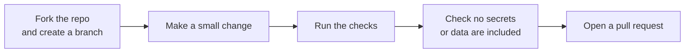

# Contributing

Thanks for helping. This page covers how to set up, what to keep stable and how to submit a change.

## Set up

Follow [Getting started](getting-started.md). For development you can run the whole app with `PROFILE=mock`, which needs no API keys. Use <http://localhost:3000/avatar> to check every avatar state and reduced-motion behaviour.

## Make a change



1. Fork the repository and create a branch.
2. Keep changes small and focused.
3. Run the checks below.
4. Review your diff. Confirm it contains no credentials, session data, databases or deployment account details.
5. Push the branch to your fork and open a pull request against [mgwinthrop/interview-studio](https://github.com/mgwinthrop/interview-studio).

## Run the checks

```sh
npm test                                  # backend unit tests and the keyless conversation test
npm --prefix apps/frontend test           # frontend unit tests
npm --prefix apps/frontend run lint
npm --prefix apps/frontend run build
npm --prefix apps/backend run build
npm --prefix apps/frontend run test:e2e   # browser smoke tests (see below)
```

`npm test` needs no keys and no running server. A single file runs with `cd apps/backend && npx vitest run src/__tests__/orchestrator.test.ts`.

### Frontend tests

- **Unit tests** (`apps/frontend/tests/unit/`, vitest) cover the pure logic under `app/`: the report and draft parsers, the same-site path checks, PCM encoding, chart maths and wording, and the settings and calls validators. Add a test next to the ones for the module you change. A test that touches `sessionStorage` starts with `// @vitest-environment jsdom`.
- **Browser smoke tests** (`apps/frontend/e2e/`, Playwright) run the real app in mock mode with a fake microphone: every page loads without console errors, the cross-origin isolation headers and VAD assets are served, and a live mock conversation connects and reaches the listening state. One-time setup: `npx playwright install chromium` in `apps/frontend`. Then `npm run test:e2e` builds the frontend and starts the mock backend itself (ports 3000 and 3001 must be free).
- **Still manual:** real speech through a real microphone. Before a release, have one real conversation (the VAD, interrupt and playback behaviour need real audio).

An opt-in integration test (`npm run test:integration` in `apps/backend`) runs a real session against real providers with an LLM judge. It needs a running backend with real keys and is not part of `npm test`.

## What to keep stable

These are shared contracts. Change them only when that is the point of your change, and update every side together.

- **Audio and WebSocket messages.** Keep the client, the server and [the protocol doc](websocket-protocol.md) in sync.
- **Preset interviewer ids:** `tell-a-story`, `explain-an-idea`, `rehearse-an-interview`, `work-out-a-point-of-view`.
- **Audio is never stored.** Per turn, only delivery numbers are kept.
- **Delivery numbers come from code**, never from model output.
- **Interrupts stop everything.** An interrupt must stop playback, the animation and the server's speech, language-model and transcription work, and drop queued utterances.
- **The avatar shows real state.** Its states follow actual connection, pause, interrupt and audio playback, not timers, and respect `prefers-reduced-motion`.
- **Old reports keep loading.**

Never commit provider keys, session data, databases or deployment account details. Hosting for other people needs authentication and per-user authorization first. See [Operations](operations.md).

## Adding a server test

Server tests start the real app on port 0 with mock providers and a temporary SQLite database. They live in `apps/backend/src/__tests__/server.<area>.test.ts` (session, auth-http, conversation, report, designer).

- Shared helpers are in `apps/backend/src/__tests__/helpers/server.ts` (`setupServerTestEnv`, `start`, `connect`, `makeConfig` and the message and preset constants) and `helpers/report.ts` (`seedStored`, `regenerate`, `statusOf`).
- Call `const env = setupServerTestEnv();` once at the top of the file. Then read `env.prisma`, `env.store`, `env.persistence`, `env.registry` and the rest inside tests or hooks. Reading `env` in a `describe` body throws, and calling the setup twice in one file throws.
- Add the test to the file for its area. Start a new `server.<area>.test.ts` only for a new area.

## AI coding assistants

`AGENTS.md` and `CLAUDE.md` hold the repo rules and a code map for AI assistants. They are useful for people too, because `CLAUDE.md` lists where each part of the backend and frontend lives.
