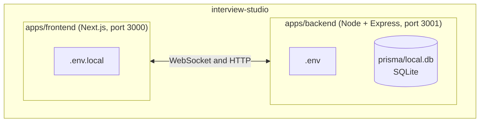
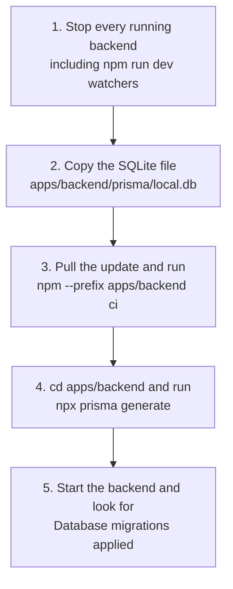

# Getting started

This page takes you from nothing to a running Interview Studio, and helps when something goes wrong. If you only want the short version, use the [Quick start in the README](../README.md#quick-start).

## What you need

| Requirement | Why | How to check |
|---|---|---|
| Node.js 20 or later | Runs both the backend and the frontend | `node -v` |
| git | To clone the repo | `git --version` |
| A modern browser and a microphone | The app asks for microphone access before the first conversation | Try the mic check on the first page |
| Ports 3000 and 3001 free | The frontend uses 3000 and the backend uses 3001 | `lsof -i :3000 -i :3001` (macOS and Linux) |
| An Anthropic API key and an ElevenLabs API key | Only for real conversations, not for mock mode | See [Get your API keys](#get-your-api-keys) |

You do not need Docker or a separate database. The app stores data in a local SQLite file.

## How the project is laid out



The two apps are independent npm projects. There is no install step at the repo root, so you install each app on its own.

## Step 1: Install

```sh
git clone https://github.com/mgwinthrop/interview-studio.git
cd interview-studio

npm --prefix apps/backend ci
npm --prefix apps/frontend ci
```

## Step 2: Create your settings files

```sh
cp apps/backend/.env.example apps/backend/.env
cp apps/frontend/.env.example apps/frontend/.env.local
```

Both files are ignored by git, so your keys stay out of commits. The defaults work for running on one machine. The next section explains each setting.

## Step 3: Generate the database client

```sh
cd apps/backend
npx prisma generate
```

You only do this once after installing, and again after the database schema changes. The backend creates the database file and applies migrations on its own the first time it starts.

## Step 4: Start the backend

You have two choices.

**Mock mode (no keys).** Replies are scripted. Use this to check that everything is wired up.

```sh
cd apps/backend
PROFILE=mock npm run dev
```

**Real mode.** Add your keys to `apps/backend/.env` first (see below), then:

```sh
cd apps/backend
npm run dev
```

Success looks like this:

```
Database migrations applied
Server listening on 127.0.0.1:3001 (profile mock, auth local)
```

In real mode the last part reads `profile cloud`.

## Step 5: Start the frontend

In a second terminal:

```sh
cd apps/frontend
npm run dev
```

Open <http://localhost:3000>. The first page checks your microphone. Then you pick an interviewer and start talking.

To preview the animated interviewer without a microphone, a backend or any keys, open <http://localhost:3000/avatar>.

## Get your API keys

| Key | Provider | Steps |
|---|---|---|
| `ANTHROPIC_API_KEY` | Anthropic | Sign in at [console.anthropic.com](https://console.anthropic.com/), add billing, then create a key under **API keys**. |
| `ELEVENLABS_API_KEY` | ElevenLabs | Sign in at [elevenlabs.io](https://elevenlabs.io/) and create a key in your profile's **API keys** section. |
| `CARTESIA_API_KEY` | Cartesia (optional) | A backup voice used only if ElevenLabs fails before any audio plays. Also set `CARTESIA_VOICE_ID`. |

Paste each key after the `=` in `apps/backend/.env`, with no quotes or spaces. Never commit this file.

Each conversation makes calls to both providers, and every report is another call. All of it is billed to your own accounts. Check each provider's pricing before long sessions.

## Settings reference

**Backend** (`apps/backend/.env`). A blank value means "use the default".

| Setting | Default | What it does |
|---|---|---|
| `PROFILE` | `cloud` | `cloud` uses the real providers and needs both keys. `mock` needs no keys. |
| `ANTHROPIC_API_KEY` | none | Required when `PROFILE=cloud`. |
| `ELEVENLABS_API_KEY` | none | Required when `PROFILE=cloud`. |
| `ELEVENLABS_VOICE_ID` | built-in voice | Choose a different interviewer voice. |
| `DATABASE_URL` | `file:./local.db` | Where the SQLite file lives, relative to `apps/backend/prisma/`. |
| `ALLOWED_ORIGIN` | `http://localhost:3000` | The address your browser uses for the frontend. |
| `HOST` | `127.0.0.1` | The address the backend listens on. A non-loopback value also requires `AUTH_TOKEN`. |
| `PORT` | `3001` | The backend port. |
| `AUTH_TOKEN` | none | Turns on shared-token mode. See [Operations](operations.md). |
| `RETENTION_DAYS` | off | Deletes sessions older than this many days, once at startup. |
| `CLOUD_SEND_TRANSCRIPTS` | off | `1` or `true` allows redacted call text to be sent to the cloud LLM for "Build from calls". See [Calls and privacy](calls-and-privacy.md). |
| `REPORT_FILLER_COUNTS` | off | `1` or `true` shows "um" and "uh" counts in reports. See [Reports](reports.md#filler-words). |
| `DEBUG_LOG_TEXT` | off | Also logs conversation text. For local debugging only. |

**Frontend** (`apps/frontend/.env.local`)

| Setting | Default | What it does |
|---|---|---|
| `NEXT_PUBLIC_WS_URL` | `ws://localhost:3001` | Where the browser finds the backend. |

## Check that it works

1. Open <http://localhost:3000>.
2. Click **Enable microphone** and allow access in the browser prompt.
3. Choose **Tell a story** and start the conversation.
4. Say a few sentences. The interviewer should reply, and the avatar should move between listening, thinking and speaking.
5. End the conversation and open the report.

In mock mode the replies are scripted, so they will not respond to what you said.

## Troubleshooting

**The backend exits straight away complaining about a key.**
`PROFILE=cloud` is the default and needs both `ANTHROPIC_API_KEY` and `ELEVENLABS_API_KEY`. Add them, or run with `PROFILE=mock`.

**The page loads but the conversation never connects.**
Check that the backend is running and printed `Server listening`. Then confirm that the address in your browser matches `ALLOWED_ORIGIN` exactly. Opening `http://127.0.0.1:3000` while the setting says `http://localhost:3000` is refused. If you changed the backend port, update `NEXT_PUBLIC_WS_URL` in `apps/frontend/.env.local` and restart the frontend.

**A port is already in use.**
Set `PORT=3002` in `apps/backend/.env` and `NEXT_PUBLIC_WS_URL=ws://localhost:3002` in `apps/frontend/.env.local`. To move the frontend, run `npm run dev -- -p 3005` and set `ALLOWED_ORIGIN=http://localhost:3005`.

**The browser never asks for microphone access, or the mic check fails.**
Check the site permission in your browser's address bar. Use headphones to avoid the interviewer's voice feeding back into your microphone.

**The backend refuses to start with a `HOST` setting.**
A `HOST` other than `127.0.0.1` also needs `AUTH_TOKEN`. This is deliberate. See [Operations](operations.md).

**Migrations fail at startup.**
The backend prints the end of Prisma's error output (with your database credentials removed) and exits. Restore your database backup if you made one, then start again. Do not delete the `_prisma_migrations` table. `cd apps/backend && npx prisma migrate status` shows which migrations applied.

**Sessions end as "failed" or reports are not saved after an update.**
The Prisma client is stale. Stop the backend, run `npx prisma generate` in `apps/backend`, and start it again.

## Updating an existing install

Updates can add database migrations. They run automatically when the backend starts, and they cannot be undone, so back up first.



Stop all backends first. A second server migrating the database under a running one breaks the running server and loses its session. Only one backend process may use a database file at a time.

This update adds the `20261108120000_llm_usage` migration (the `LlmUsage` table, which holds LLM usage as numbers and ids only).

If a migration fails or stops part-way, stop the backend, restore your copy of the SQLite file and start again.

## Next steps

- [How it works](how-it-works.md) explains what happens during a conversation.
- [Interviewers](interviewers.md) shows how to create your own.
- [Operations](operations.md) covers security and hosting.
