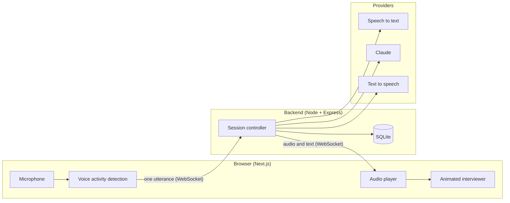
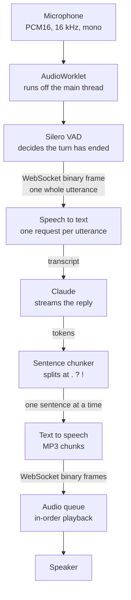
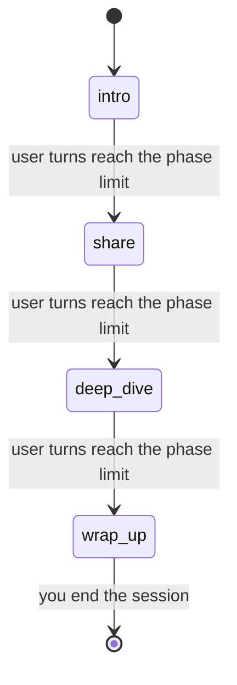
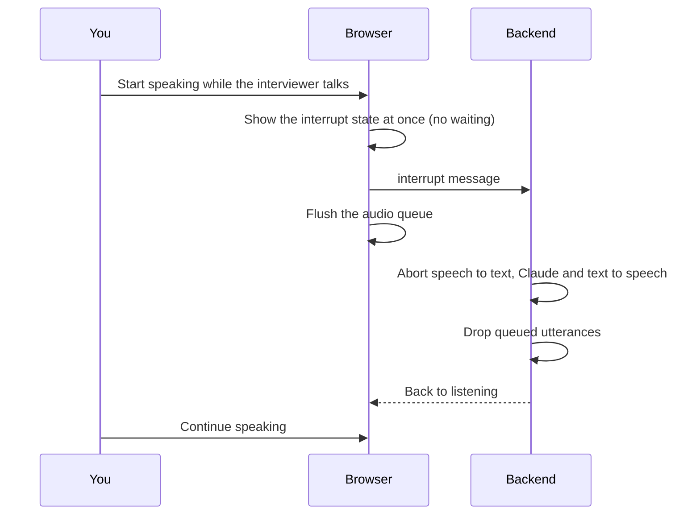
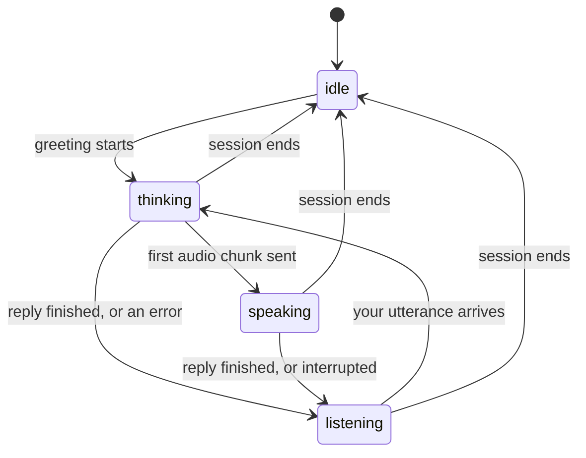
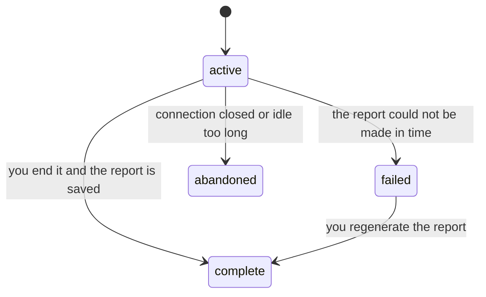

# How it works

This page explains what happens from the moment you speak to the moment you read your report. Each section has a diagram, then the details.

**On this page:** [The big picture](#the-big-picture) · [The voice pipeline](#the-voice-pipeline) · [Conversation phases](#conversation-phases) · [Interruptions](#interruptions) · [Session lifecycle](#session-lifecycle) · [Providers and mock mode](#providers-and-mock-mode) · [Technology choices](#technology-choices)

## The big picture

The browser decides when you have stopped speaking and sends one finished utterance to the backend. The backend turns it into text, asks Claude for a reply, turns the reply into speech and streams the audio back. The animated interviewer follows what is actually playing.

## The voice pipeline

Two details matter if you change this code:

- **Speech to text is not streaming.** The transcription request starts only after the whole utterance has arrived. Claude and text to speech are streamed, so the first sentence of a reply can play while the rest is still being written.
- **The server never decides when you stopped talking.** Voice activity detection runs in the browser, so end-of-turn needs no round trip.

### Latency

The target is under 1.5 seconds from the end of your speech to the first audio of the reply.

| Stage | Estimate |
|---|---|
| End-of-turn detection | 200–400 ms |
| Audio upload | about 50 ms |
| Speech to text | 300–800 ms (grows with answer length) |
| First Claude token | 300–500 ms |
| Sentence chunker | about 50 ms |
| First audio from text to speech | about 75 ms |
| Network to the browser | about 50 ms |
| **Total** | **about 1.0–1.9 s** |

These are estimates, not measurements. A long answer can push the total past the target. The server sends a `latency_metric` message with the measured time for each reply, so you can check real runs. Mock mode has no provider delay and tells you nothing about latency.

## Conversation phases

Phases belong to the interviewer. The four presets use the phases above. A custom interviewer can have 1 to 8 phases with names of its own.

**Claude never decides when to move on.** After each reply, the backend counts your turns in the current phase. When the count reaches that phase's limit, the next phase begins. The last phase has no limit, so a conversation only ends when you end it.

The presets allow up to 2 turns in `intro`, 3 in `share` and 5 in `deep_dive`. That makes the cumulative thresholds 2, 5 and 10 turns. A demo option makes every phase end at its minimum instead, for quick walkthroughs.

## Interruptions

You can talk over the interviewer. Interrupts are the part most likely to break, so both sides stop together.

Three rules keep this reliable:

1. The browser changes the avatar and stops playback **before** it hears back from the server.
2. One abort signal cancels speech to text, Claude and text to speech for the turn, so nothing more is sent.
3. The interrupted reply is not stored. Your own turn is.

## Session lifecycle

Inside the backend, one session controller handles each connection. It is always in one of four states.

- One item runs at a time. Utterances that arrive meanwhile wait in a queue of up to 5. Beyond that the server sends a non-fatal `busy` error.
- A session ends itself after 200 of your turns.

### How a stored session ends

| Status | Meaning |
|---|---|
| `active` | Running, or its report is still being written. |
| `complete` | Ended normally and the report is stored. Only these appear in your history. |
| `failed` | Ended, but the report could not be made. You can regenerate it from the report page. |
| `abandoned` | The connection closed first, or the session sat idle for 15 minutes. |

A session leaves `active` exactly once. The only other move is `failed` to `complete`, when you regenerate a report. Ending has a 90-second deadline. If the last reply and the report are not done by then, everything is cancelled and the session becomes `failed`. A session is never `complete` without a stored report.

When the backend starts, any session still marked `active` is marked `abandoned`, because a crash or restart must have left it behind.

## Providers and mock mode

The backend talks to speech and language services through three interfaces in `apps/backend/src/providers/types.ts`.

| Interface | Cloud implementation |
|---|---|
| Speech to text | ElevenLabs Scribe (default `scribe_v2`; one REST request per utterance) |
| Language model | Claude, for replies, reports and drafts (models chosen on the [Settings page](settings.md)) |
| Text to speech | ElevenLabs (default `eleven_flash_v2_5`), with Cartesia `sonic-english` (fixed) as a fallback if ElevenLabs fails before any audio plays |

`PROFILE` chooses the set:

- `cloud` (default) uses the real services and needs both API keys. Startup fails with a clear message if one is missing.
- `mock` uses scripted in-process providers with no keys and no network. It runs a full conversation, including interruption and report, and the keyless tests use it.

## Technology choices

These are the built-in defaults. The Claude models, reply length, speech-to-text model, text-to-speech model and spoken-reply format can be changed on the Settings page; see [Settings](settings.md). The microphone format (16 kHz PCM16), the voice detection model and the Cartesia fallback stay fixed. Defaults for the Claude models are picked from Anthropic's live model list and remembered.

| Choice | Built-in default | Why |
|---|---|---|
| Conversation model | `claude-sonnet-4-6` (used when no model is saved and the list cannot be loaded; otherwise the recommended Fast-tier model is picked and saved) | Balance of latency and quality |
| Reply length limit | `max_tokens: 300` (settable from 50 to 1000) | Keeps replies short enough to speak. The report call is separate and uses 3072. |
| Speech to text | ElevenLabs `scribe_v2` (typed id) | Accurate for voice |
| Text to speech | `eleven_flash_v2_5` | Lowest-latency ElevenLabs model |
| Spoken-reply format | `mp3_44100_128` (MP3 variants only) | The browser player and protocol assume MP3 |
| Fallback voice (fixed) | Cartesia `sonic-english` | An independent provider covers ElevenLabs outages |
| Voice activity detection (fixed) | `@ricky0123/vad-web` (Silero) | Runs in the browser, so no round trip to find the end of a turn. Its model and ONNX Runtime files are served by the app itself, never a CDN. If it has not started listening 10 s after a session opens, the session says so and opens typing. Sessions record from the microphone chosen on the mic check (remembered in this browser only); if it is missing, the default is used and the session says so |
| Microphone format (fixed) | 16 kHz mono PCM16 | The best input format for Scribe v2 |

## Where to go next

- [Interviewers](interviewers.md): what an interviewer is made of.
- [Reports](reports.md): how the report is built.
- [WebSocket protocol](websocket-protocol.md): every message between browser and backend.
