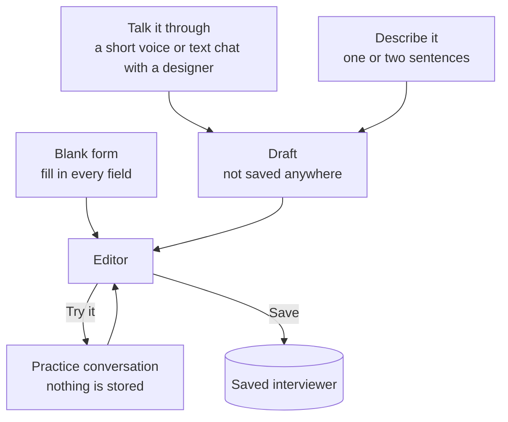
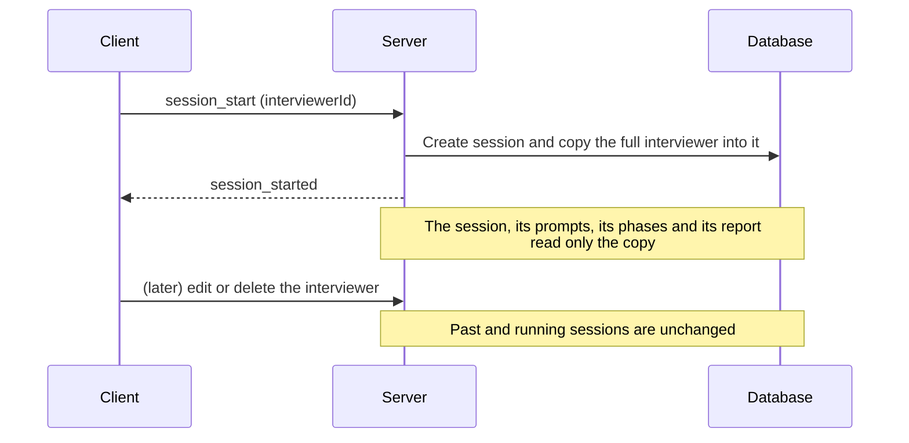

# Interviewers

An interviewer defines one kind of conversation: who the interviewer is, how it speaks, the phases the conversation moves through and what the report should notice.

**On this page:** [What an interviewer contains](#what-an-interviewer-contains) · [Presets](#presets) · [Creating your own](#creating-your-own) · [Snapshots](#snapshots) · [How the prompt is built](#how-the-prompt-is-built) · [HTTP API](#http-api) · [For contributors](#for-contributors)

## What an interviewer contains

| Field | What it does |
|---|---|
| `name` | Shown in the app and on reports. |
| `purpose` | One line saying what the interviewer is for. |
| `persona` | Who the interviewer is. |
| `style` | How it speaks. |
| `opening` | Guidance for the first turn only. |
| `closing` | Guidance for the last phase only. |
| `phases` | 1 to 8 steps. Each has a unique `name` and an `instruction`. Every phase except the last also has `minTurns` and `maxTurns`. |
| `focus` | Up to 6 things the report should pay attention to. |
| `contentFeedback` | Whether the report covers what you said. |
| `deliveryFeedback` | Whether the report covers how you said it. |
| `voice` | Optional. Stored and checked, but the speech providers do not use it yet. |

At least one of the two feedback switches must be on. The server adds `id`, `source` (`preset` or `custom`), `ownerId`, `version` and timestamps. Text is trimmed, control characters are rejected and unknown fields are refused. The field limits are in `apps/backend/src/interviewer/schema.ts`.

## Presets

Four presets ship in the repo under `apps/backend/src/interviewer/presets/`:

| ID | For |
|---|---|
| `tell-a-story` | Telling a story that matters to you |
| `explain-an-idea` | Explaining something so a newcomer can follow |
| `rehearse-an-interview` | Practising interview answers out loud |
| `work-out-a-point-of-view` | Thinking aloud with a thoughtful partner |

All four use the phases `intro`, `share`, `deep_dive` and `wrap_up`. Presets are read-only. To change one, duplicate it and edit the copy.

A fifth, hidden preset (`interviewer-designer`) powers the "Talk it through" designer. It is not listed by the API.

At startup, after migrations, the backend validates every preset file and writes it to the database in one transaction. A preset that fails validation stops startup. Your custom interviewers and sessions are never touched by this sync.

## Creating your own

Open **Interviewers** in the app. There are three ways to start.

- A **draft** is only a proposal. Nothing saves it until you press **Save**.
- **Try it** runs a practice conversation with the interviewer as it stands in the form. No session, transcript or report is kept, and nothing appears in your history.
- The designer conversation also stores nothing.
- You can keep up to 50 custom interviewers.
- You can duplicate, edit and delete custom interviewers on the Interviewers page.

Editing is safe against overwrites. Every update carries the `version` it was based on. If someone saved in the meantime, the server answers `409` instead of replacing their work.

## Snapshots

When a session starts, the server copies the whole interviewer record into the session (`Session.interviewerJson`). Editing or deleting the interviewer, or changing a preset file, never changes a past or running session or its report.

Sessions saved before interviewers existed have no snapshot. They show as **Earlier interview**.

## How the prompt is built

For each turn, `buildSystemPrompt` in `interviewer/prompt.ts` joins these parts in order:

1. A fixed set of voice rules (code, not editable).
2. The interviewer's `persona`.
3. Its `style`.
4. The current phase's `instruction`.
5. The `opening` guidance, on the first turn only.
6. The `closing` guidance, in the last phase only.
7. A final reminder of the voice rules.

The reminder comes last so text written by an interviewer author can never override the rules. The report uses a separate prompt, described in [Reports](reports.md).

## HTTP API

All routes require authentication and are scoped to the caller. Bodies are JSON, up to 64 KB.

| Route | Result |
|---|---|
| `GET /api/interviewers` | Summaries of the presets, then your custom interviewers, each ordered by name. |
| `GET /api/interviewers/:id` | The full record. `404` for an unknown id or someone else's interviewer. |
| `POST /api/interviewers` | `201` with the new record at version 1. `422` for invalid input or at the 50 limit. |
| `PUT /api/interviewers/:id` | The full input plus `version`. `403` for a preset, `409` for a stale version, `422` for invalid input. |
| `POST /api/interviewers/:id/duplicate` | `201` with a copy named `<name> (copy)`. |
| `DELETE /api/interviewers/:id` | `204`. `403` for a preset. |
| `POST /api/interviewers/draft` | Body `{ description }` of 20 to 4000 characters. Returns `{ draft }`. `429` while another draft is running for you, `502` if drafting fails. |

An id must be 1 to 64 letters, digits, `_` or `-`; anything else is a `404`. Errors never repeat what you submitted.

## For contributors

**Ephemeral sessions.** A `session_start` with `interviewerId: "interviewer-designer"` runs a designer session. One with an inline `draft` runs a trial. Both use `EPHEMERAL_PERSIST` in `wsServer.ts` and never write a session, turn, phase or report row. They share the start path of a stored session, including the concurrent-session cap, turn cap and idle timeout.

**Draft generation.** `generateDraft` in `interviewer/designer.ts` makes one structured model call, either over the designer conversation (sent as a `draft` message just before `session_complete`) or over a one-box description. Only known input fields are kept, and the result must pass `parseInterviewerInput`, exactly like a save. The call has its own output budget (`DRAFT_MAX_TOKENS`, 6144) and is bounded by `limits.reportTimeoutMs`. A designer session that cannot make a valid draft ends as `session_failed`.

**Frontend hand-off.** The draft reaches the editor and Try it through `sessionStorage` under `interviewer_draft`, written and read by `apps/frontend/app/lib/interviewerForm.ts`. The value is shape-checked on read, and a corrupt one opens a blank form. Nothing is saved except by **Save**, which calls `POST` or `PUT /api/interviewers`.

**Field limits are duplicated.** The editor uses a copy of `INTERVIEWER_LIMITS` from `apps/backend/src/interviewer/schema.ts`, kept in `apps/frontend/app/lib/interviewerForm.ts`. A backend test (`interviewerSchema.test.ts`) pins the numbers. To change a limit, update both files and the test. The server remains the authority.

**Phase names on the wire.** `phase_change` carries the phase name from the snapshot, so clients must not assume a fixed set of names.
