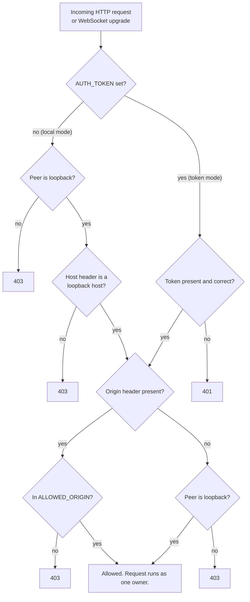
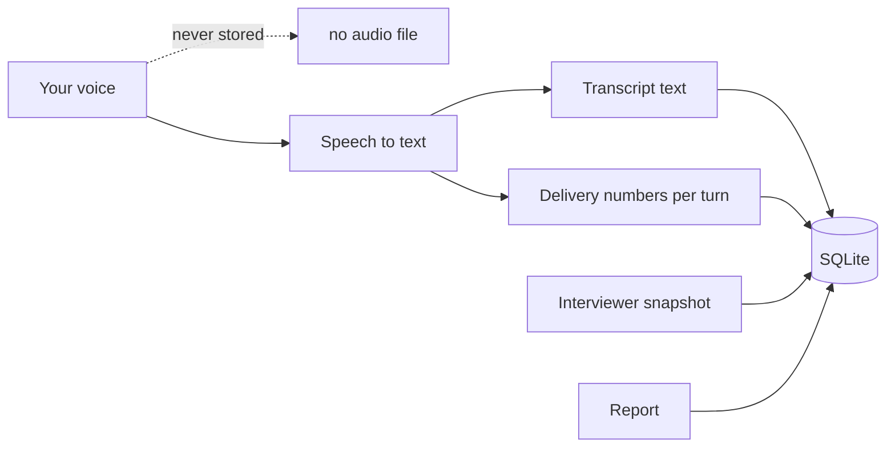

# Operations

How Interview Studio protects itself by default, what it stores, and what to do before you put it anywhere other than your own machine.

**On this page:** [Before you put this on a network](#before-you-put-this-on-a-network) · [Access control](#access-control) · [Limits](#limits) · [What is stored](#what-is-stored) · [Logging](#logging) · [Hosting](#hosting) · [Health check](#health-check)

## Before you put this on a network

Interview Studio is a **single-user prototype**. It has no user accounts. Publishing the source code does not make it suitable for public hosting.

- Speech goes to your speech provider, and transcripts go to your language model provider. Use practice content, not confidential interview or candidate data.
- Provider calls are billed to your own accounts.
- Before exposing it to other people, add real authentication, per-user authorization, usage controls and retention rules.

## Access control

The same checks run on every HTTP route and every WebSocket upgrade, in `apps/backend/src/auth.ts`. The result is an `ownerId`, and every query is filtered by it. Another owner's data answers `404`.

**Local mode (default).** No `AUTH_TOKEN`. Only connections from your own machine are accepted. The `Host` header must also name a loopback host, which stops a web page from reaching the server through DNS rebinding.

**Token mode.** Set `AUTH_TOKEN` to a long random string. Send it as `Authorization: Bearer <token>`. Browsers cannot set headers on a WebSocket, so the browser client may connect with `ws://host/?token=<token>`. That puts the secret in the URL, so make sure no proxy or platform logs full request URLs. The server itself never logs them.

**Safe by default.** `HOST` defaults to `127.0.0.1`. If you set any other `HOST` without `AUTH_TOKEN`, the server refuses to start.

**Reverse proxies.** A proxy on the same machine connects from loopback, so every client it forwards looks local and passes the local-mode check. If you use a proxy, set `AUTH_TOKEN` or make sure the proxy cannot be reached from other machines.

## Limits

| Limit | Value | What happens |
|---|---|---|
| One audio frame | 10 MiB (about 5.5 minutes of speech) | Connection closed with code 1009 |
| One JSON message | 64 KiB | Closed with 1009, `message too large` |
| One typed answer | 8 KB | Ignored, with a `too_long` error |
| Concurrent sessions per owner | 2 | Closed with 1013 |
| Idle time | 15 minutes | Closed with 1001, session `abandoned` |
| Your turns per session | 200 | The session ends itself |
| Ending a session (last reply plus report) | 90 seconds | Session becomes `failed` |
| Custom interviewers per owner | 50 | `422` on create |

All close codes are listed in the [WebSocket protocol](websocket-protocol.md#close-codes).

## What is stored

- **Audio is never stored.** Per turn, only the transcript text and the delivery numbers are kept.
- The database is the SQLite file named by `DATABASE_URL`. Never hard-code or commit it.
- A session is written when it starts (with its interviewer snapshot), on each completed turn, on phase changes and when it ends.
- **Deleting a session** (`DELETE /api/session/:sessionId`, or the button on the dashboard) removes it with its turns and report. A live session cannot be deleted (`409`).
- **Deleting an interviewer** removes only the interviewer. Sessions keep their own copy.
- **Retention** is off by default. Set `RETENTION_DAYS` to delete ended sessions older than that, once at startup. A failure is logged and does not block startup.
- **Migrations** run at startup. If one fails, the server prints the end of Prisma's error output with credentials removed and exits.
- Designer and "Try it" sessions store nothing at all.

## Logging

- Logs carry session ids, event names, byte counts and error class names only.
- They never contain transcript text, model output, audio, API keys or tokens.
- Request URLs are never logged, because `?token=` can appear in them.
- `DEBUG_LOG_TEXT=true` also logs conversation text. It is off by default and meant for local debugging only.

## Hosting

The backend is one long-running Node process that serves WebSocket and HTTP, with a SQLite file on persistent storage. It needs a host with a persistent disk, and only one backend process may use a database file. The frontend is a standard Next.js app.

`apps/backend/fly.toml` is provided as a starting point for Fly.io. It deliberately has no app name, so pass your own with `--app YOUR_APP`, and create your own volume and secrets. Create the frontend project in your own hosting account and set `NEXT_PUBLIC_WS_URL` to your backend. Use separate credentials for each environment.

Nothing in the repo includes deployment account details, and none should be committed.

## Health check

`GET /health` returns `{ status, database, providers: { profile } }`. It sits behind the same authentication as every other route.
