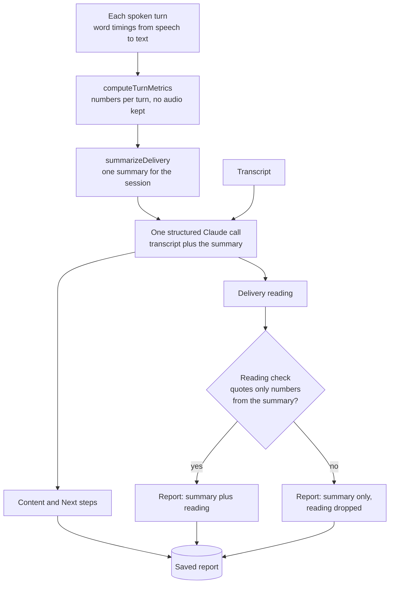

# Reports

After a conversation ends, Interview Studio writes a reflective report. It has no scores, ratings or grades.

**On this page:** [What's in a report](#whats-in-a-report) · [How a report is made](#how-a-report-is-made) · [Delivery numbers](#delivery-numbers) · [The reading check](#the-reading-check) · [Filler words](#filler-words) · [Failed reports](#failed-reports) · [For contributors](#for-contributors)

## What's in a report

| Part | What it covers | Where it comes from |
|---|---|---|
| **Content** | A summary, up to 4 strengths (each with an exact quote from you) and up to 4 areas to develop | Written by Claude |
| **Delivery** | Pace, pauses, answer length and how quickly you started answering, plus a plain-language reading | Numbers are computed in code. Claude writes only the reading. |
| **Next steps** | One or two things to try next | Written by Claude |

Which parts appear depends on the interviewer's `contentFeedback` and `deliveryFeedback` switches. If delivery is on but nothing spoken was measured (for example you only typed), the report says delivery was not measured.

## The transcript

The report's **Transcript** tab shows the whole conversation on the page, in order, with each of your answers in full and labelled "Answer N". The download (a `.txt` file) is still there. If the conversation cannot be loaded, the tab offers only the download and the rest of the report is unchanged.

For contributors: the page reads `GET /api/session/:sessionId/turns`, which is owner-scoped and returns 404 exactly like the text download at `/api/session/:sessionId/transcript`. It returns `{ turns: [{ role, content, phase, answer? }] }` and nothing else (no ids, timestamps or metrics). `answer` is set on your turns only. It counts every one of your turns in order, typed or spoken, which is the same rule as the report's "Answer by answer" (`summarizeDelivery`), so "Answer 3" means the same turn in both places (`apps/backend/src/transcriptTurns.ts`).

## How a report is made

The numbers in a report always come from code. The model never produces them, and it is told not to quote any number that is not in the summary.

## Delivery numbers

Computed per spoken turn by `apps/backend/src/delivery/metrics.ts`. A value is `null` when unknown, and `null` is never shown as zero.

| Metric | Definition |
|---|---|
| Pause | A gap of at least 0.7 seconds between two timed words. Reported as a count and the longest pause. |
| Pace | Words per minute from your first word to your last. `null` if the answer is under 2 seconds or has fewer than 5 timed words. |
| Answer length | Word count and duration. |
| Response gap | The time between the interviewer finishing and you starting. The browser measures it and sends it as `turn_timing` before your audio. `null` for a first answer, a typed answer, or when you spoke over the interviewer. |
| Fillers | The count of `um, uh, uhm, er, erm, ah, hmm, mm, mmm`, matched as whole words. "Umbrella" does not count. |

Only these numbers are stored for a turn, in `ConversationTurn.metricsJson`. No audio and no word list is kept. Typed turns have no delivery numbers.

For the whole session, `summarizeDelivery` adds up words, speaking time and pauses and takes the longest pause. Average pace is total words over total time, not the average of per-turn paces. The response gap is the median across turns.

## The reading check

Claude writes a short "In plain words" reading of the delivery numbers. Code then checks it.

Every number written in digits in the reading must match a value in the summary. The check is lenient about rounding and units, so 142.3 words per minute may be written "142", and a 1,200 ms gap may be written "1.2 seconds". It is strict about invented numbers.

If the reading fails the check, the report still completes. The reading is left out, the code-computed summary stays, and the server logs a fixed line with no text from the reading. The report page shows the "In plain words" block only when a reading exists.

Number words ("three answers") are not checked. The full rules are in `apps/backend/src/delivery/readingCheck.ts`.

## Filler words

Filler counts are stored for every turn, but reports hide them by default. The speech-to-text service may drop words like "um" from its transcript, and this could not be confirmed from its public documentation. A count of zero would then be misleading.

To check and turn them on:

1. Run a conversation in which you say "um" and "uh" several times on purpose.
2. Open the database and look at the `metricsJson` of those turns. `fillerCount` should be above zero and roughly match what you said.
3. Set `REPORT_FILLER_COUNTS=1` in `apps/backend/.env` and restart the backend.

## Failed reports

If a report cannot be made (a provider error, an invalid reply or the 90-second deadline), the session becomes `failed`. The report page shows a **Regenerate** button when the session has at least one of your turns.

`POST /api/session/:sessionId/report/regenerate` runs the same generation again, with the same deadline:

| Status | Meaning |
|---|---|
| 200 | The new report. The session is now `complete`. |
| 404 | Unknown, foreign or malformed session id. |
| 409 | The session is not `failed`, has no user turns or interviewer snapshot, or a regeneration is already running. |
| 502 | Generation failed again or hit the deadline. The session stays `failed`. |

## For contributors

- **Prompt order.** The report system prompt is a fixed introduction, then the interviewer's `name`, `purpose`, `persona` and `focus`, then the fixed report instructions. The instructions come last so interviewer text never follows them. The user message holds only the numbers and the transcript, and the model is told it is material, not instructions.
- **Token budget.** The report call uses `max_tokens: 3072` (`REPORT_MAX_TOKENS`), an exception to the conversational reply limit (300 tokens by default). The largest valid report is about 2,300 tokens. A reply cut off by the budget would fail validation and lose the report, so a test fails if a field limit is raised past the budget.
- **Validation.** The output is checked against a schema built for the request. Requested parts are required and anything else is dropped. A report that fails validation after one retry fails the session.
- **Storage and old reports.** `Report.reportJson` holds a `ReportV2` (`format: 2`). The older report columns are still filled from it, and a row without `reportJson` is served as `format: 1` and renders as before. Old reports must keep loading.
- **Reading is optional.** `ReportV2.delivery.reading` may be absent. Reports stored before the check always have one.
- **Regeneration writes once.** `completeFailedSession` saves the report and the status change in one transaction, and only for a `failed` session of the right owner. It is the one exception to "a session leaves `active` exactly once".
- **Types.** The report shape and limits are in `reportGenerator.ts` (`ReportV2`, `REPORT_LIMITS`). The frontend parser is `apps/frontend/app/lib/report.ts`.
