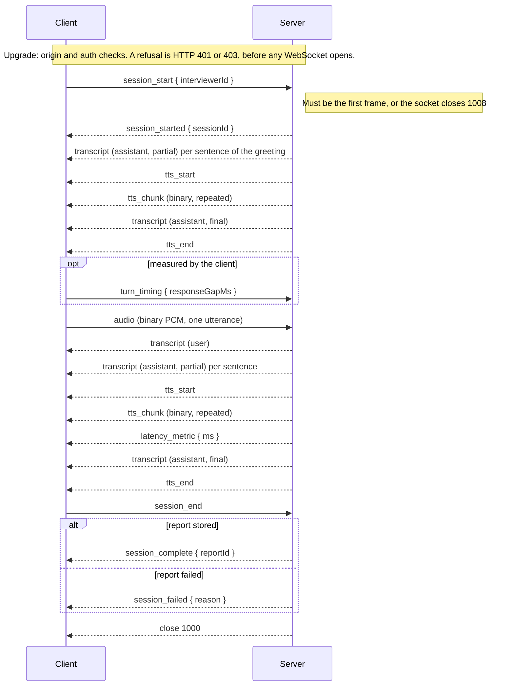

# WebSocket Protocol

This is the reference for the messages between the browser and the backend. Read it if you are building a client or changing the protocol. For the big picture first, see [How it works](how-it-works.md).

The backend exposes a single WebSocket endpoint at the root path (`ws://host/`). All JSON messages are typed — never send untyped blobs. Binary frames carry audio data only.

**On this page:** [Typical session flow](#typical-session-flow) · [Connection](#connection) · [Sessions](#sessions) · [Client → Server](#client--server) · [Server → Client](#server--client) · [Close codes](#close-codes) · [Binary frame detection](#binary-frame-detection)

## Connection

```
ws://localhost:3001               # local dev
wss://YOUR_BACKEND  # optional hosted deployment
```

### Authentication and origin (checked on upgrade)

The upgrade request goes through the same authenticator as every HTTP route, before the WebSocket handshake. A refused upgrade gets a plain HTTP error and the socket is closed; no WebSocket is opened.

| Check | Refusal |
|---|---|
| `Origin` header present but not in `ALLOWED_ORIGIN` | HTTP 403 |
| No `Origin` header and the peer is not loopback | HTTP 403 |
| Local mode (no `AUTH_TOKEN`) and the peer is not loopback | HTTP 403 |
| Local mode and the `Host` header is missing or not a loopback host (`localhost`, `127.0.0.0/8`, `[::1]`, any port; guards against DNS rebinding) | HTTP 403 |
| Token mode (`AUTH_TOKEN` set) and the token is missing or wrong | HTTP 401 |

In token mode the token is sent as `Authorization: Bearer <token>`. Browsers cannot set headers on a WebSocket, so the browser client may instead connect to `ws://host/?token=<token>`. The `?token=` form is for the browser WebSocket only; because it puts the secret in the URL, request URLs must never be logged (the server does not log them).

### Running behind a reverse proxy

In local mode the server trusts loopback peers. A reverse proxy on the same host connects from loopback, so every remote client it forwards looks local and passes the check. If you put a proxy in front of the backend, set `AUTH_TOKEN` (token mode), or make sure the proxy is not reachable from other machines. Do not log full request URLs at the proxy either.

## Sessions

- The server issues session IDs. The client never chooses one: any `sessionId` or `phase` field in `session_start` is ignored, and every session starts in its interviewer's first phase.
- Sessions are single-connection. There is no reattach: a new connection is a new session with a new ID, and reconnecting after a drop starts a new conversation.
- The first frame on a socket must be a valid JSON `session_start` with **exactly one** of `interviewerId` and `draft`. An `interviewerId` must name an interviewer the caller can see: a preset ID (visible to everyone), the designer (`"interviewer-designer"`) or the ID of one of the caller's own custom interviewers. A `draft` runs an unsaved interviewer ("Try it"). A second `session_start` on the same socket is ignored.
- `topicId` is gone. A `session_start` that carries `topicId` but no `interviewerId` is treated as a missing ID and closed 1008.
- Malformed JSON text frames after `session_start` are ignored. Unknown message types are ignored.

### Designer and trial sessions (ephemeral)

Two kinds of session store no session content: no session row, no turns, no phase changes and no report (they write only numbers-only usage rows, with an owner id and no session id), so they never appear in `/api/sessions` and the report and transcript routes answer 404 for their IDs. `DELETE /api/session/:sessionId` answers 409 for one that is still live, like any live session, and 404 once it has ended. Everything else is as for a stored session: a server-issued `sessionId`, the same message flow, and the same concurrent-session cap, turn cap and idle timeout.

- **Designer** (`interviewerId: "interviewer-designer"`): a hidden preset that talks through the interviewer the person wants. On `session_end` the server makes one draft from the conversation and sends `draft`, then `session_complete`. If there is too little to go on, or the draft call fails or times out, it sends `session_failed` and no `draft`.
- **Trial** (`draft: {...}`): runs the given draft as the interviewer. On `session_end` it sends `session_complete` with no report; a trial with no user turns also ends `complete`.

A draft reaches the server's store only when the client saves it through `POST`/`PUT /api/interviewers`.

### Interviewer snapshot

When a stored session is created, the server copies the full interviewer definition into the session row (the snapshot), in the same write that creates the row and before `session_started` is sent. The running session, its phases and its report use only that snapshot: editing or deleting the interviewer afterwards does not affect a session that has already started, or its report.

### Session statuses

| Status | Meaning |
|---|---|
| `active` | The session is running (or its report is still being generated). |
| `complete` | `session_end` was received and the report was stored. Only complete sessions are listed in `/api/sessions`. |
| `failed` | The session ended but the report could not be generated or stored. |
| `abandoned` | The socket closed before `session_end`, or the session idled out. |

A session leaves `active` exactly once. The only other transition is `failed` to `complete`, made over HTTP when a failed report is regenerated (`POST /api/session/:sessionId/report/regenerate`, see [Reports](reports.md#failed-reports)); it is not a WebSocket message. If the socket closes after `session_end` has been sent, the report is still generated and the session can still become `complete`. Ending is bounded: if the in-flight turn and the report have not finished within `limits.reportTimeoutMs` (90 seconds by default) of `session_end`, both are aborted, the session becomes `failed` and the server sends `session_failed` (if the socket is still open).

## Client → Server

All client messages are JSON strings except `audio` frames which are **raw binary** (ArrayBuffer).

| Type | Payload | Notes |
|---|---|---|
| `audio` | Raw PCM16 binary frame | Sent as binary WebSocket frame, not JSON. 16kHz mono, one complete utterance (end of turn decided by the client VAD). Only accepted after `session_start`. At most `limits.maxPayloadBytes` (10 MiB, about 5.5 minutes); a larger frame closes the socket 1009. |
| `session_start` | `{ type, interviewerId, demo? }` or `{ type, draft, demo? }` | Must be the first frame. **Must include exactly one of `interviewerId` and `draft`.** `interviewerId` is a string of 1 to 64 letters, digits, `_` or `-` naming a preset (`"tell-a-story"`, `"explain-an-idea"`, `"rehearse-an-interview"`, `"work-out-a-point-of-view"`), the designer (`"interviewer-designer"`, not listed by `GET /api/interviewers`) or one of the caller's custom interviewers (`GET /api/interviewers` lists the presets and those). `draft` is an interviewer input object with the same shape and rules as the body of `POST /api/interviewers` (no `id`, `version` or other stored fields) and starts a trial session. `demo` makes every phase end at its `minTurns` instead of its `maxTurns`. |
| `session_end` | `{ type }` | Ends the session: cancels any in-flight reply as `interrupt` does (no further audio, no final transcript or `tts_end`, and the reply is not stored), generates the report from the committed turns, then the server sends `session_complete` or `session_failed`. |
| `interrupt` | `{ type }` | Cancels in-flight STT, LLM and TTS and drops queued utterances. Server resets for next user turn. |
| `text_input` | `{ type, content: string }` | Text fallback — bypasses STT. Treated identically to a completed voice turn. Empty or whitespace-only content is ignored. Content over 8192 UTF-8 bytes is ignored and answered with `stt_error` reason `too_long`. |
| `turn_timing` | `{ type, responseGapMs: number }` | Optional, sent immediately before the `audio` frame it belongs to. `responseGapMs` is the time in milliseconds between the end of the interviewer's playback and the start of the user's speech, measured by the client. Omitted when not applicable (for example the first answer with no playback before it, a `text_input` turn, or when the user spoke over the interviewer). Only accepted after `session_start`. Must be a finite number from 0 to 600000; any other value is ignored and the socket stays open. The server attaches it to the next `audio` frame only: it is never applied to a `text_input` turn, a later note replaces an earlier one, and a `text_input` turn, `interrupt` or `session_end` discards one still waiting. It is stored only as a number on that turn's delivery metrics and is never logged. |

## Server → Client

All server messages are JSON strings except `tts_chunk` which is a **raw binary frame**.

| Type | Payload | When sent |
|---|---|---|
| `session_started` | `{ type, sessionId }` | First message after a valid `session_start`, before the greeting. `sessionId` is the server-issued UUID used for the report and transcript URLs. |
| `tts_chunk` | Raw MP3 binary frame | Each audio chunk during TTS streaming. Sent as binary WebSocket frame. |
| `tts_start` | `{ type }` | Before the first `tts_chunk` of a turn. Signals AI is now speaking. |
| `tts_end` | `{ type }` | After the last `tts_chunk` of a turn. Signals AI has finished speaking. Suppressed if TTS is aborted. |
| `transcript` | `{ type, text, role, partial? }` | User transcript after STT (`role: "user"`). AI transcript per sentence chunk (`role: "assistant"`, `partial: true` mid-turn, final without `partial` once the reply is complete). |
| `phase_change` | `{ type, phase }` | When the server transitions to the next phase. `phase` is the new phase's name, a string taken from the interviewer's snapshot. The presets use `"intro"`, `"share"`, `"deep_dive"` and `"wrap_up"`; a custom interviewer names its own phases (1 to 8 of them), so clients must not assume a fixed set. |
| `draft` | `{ type, draft }` | Designer sessions only, just before `session_complete`. `draft` is an interviewer input object that has passed the same validation as `POST /api/interviewers` (never a `voice`). It is not saved. |
| `session_complete` | `{ type, reportId }` | The session ended as `complete`. For a stored session its report is stored and `reportId` is the session ID. For a designer or trial session `reportId` is still the session ID but names no stored report; clients ignore it. The server then closes the socket normally (1000). |
| `session_failed` | `{ type, reason }` | The session ended as `failed` (no report). `reason` is a short fixed string, never model output or transcript text. The server then closes the socket normally (1000). |
| `stt_error` | `{ type, reason }` | Non-fatal input failure (`low_confidence`, `stt_failed`, `busy` when the utterance queue is full, or `too_long` when a `text_input` is over 8192 bytes). Client should show a toast; session continues. |
| `latency_metric` | `{ type, ms }` | Emitted on the first `tts_chunk` of a reply. `ms` = elapsed time since the server received the user's utterance. |

## Close codes

| Code | Reason | When |
|---|---|---|
| 1000 | `session complete` / `session failed` | After `session_complete` or `session_failed`. |
| 1001 | `idle timeout` | The session received no client activity for the idle limit and was marked `abandoned`. No JSON message is sent first. (`server shutdown` when the server stops.) |
| 1008 | `session_start required` / `unknown interviewerId` / `invalid draft` | The first frame was binary, malformed or another message type (`session_start required`); or a `session_start` without `draft` whose `interviewerId` is missing, not a string, empty, longer than 64 characters, malformed, unknown, or another owner's custom interviewer (`unknown interviewerId`; every one of these cases gets the same response); or a `session_start` with `draft` that also has `interviewerId`, or whose `draft` is not an object (an array, `null`, a string or a number), has an unknown field, a missing field, a field over its cap, both feedback switches off, or otherwise fails the rules of `POST /api/interviewers` (`invalid draft`, never echoing the draft). Nothing is created and the concurrent-session count is not touched. |
| 1009 | (set by the `ws` library) / `message too large` | A frame was larger than its limit: any frame over `limits.maxPayloadBytes` (10 MiB by default, about 5.5 minutes of 16 kHz PCM16 audio in one utterance) is closed by the `ws` library; a JSON text frame over `limits.maxTextFrameBytes` (64 KiB by default) is closed by the server with reason `message too large`. |
| 1011 | `internal error` | The session could not be created (the interviewer lookup or the database write failed). No `session_started` is sent. |
| 1013 | `too many sessions` | The owner already has the maximum number of concurrent sessions (2 by default). Nothing is created. |

## Binary frame detection

The server uses the `isBinary` flag from the `ws` library to distinguish audio frames from JSON messages:

```typescript
ws.on('message', (data, isBinary) => {
  if (isBinary) {
    // PCM16 audio frame — forward to STT
  } else {
    // JSON message — parse and route by type
  }
});
```

The client sets `ws.binaryType = "arraybuffer"` so binary frames arrive as `ArrayBuffer`, not `Blob`.

## Typical session flow



An `interrupt` message can arrive at any point while the server is thinking or speaking. See [Interruptions](how-it-works.md#interruptions).
